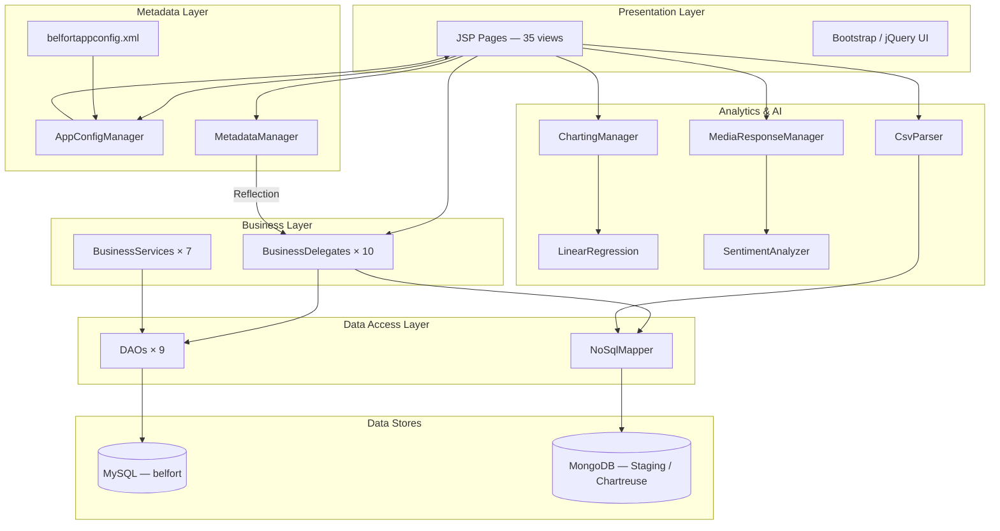
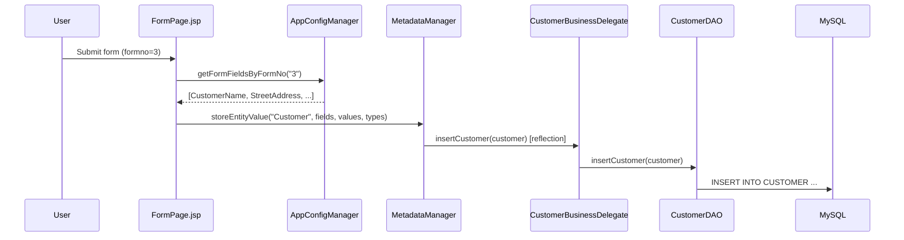
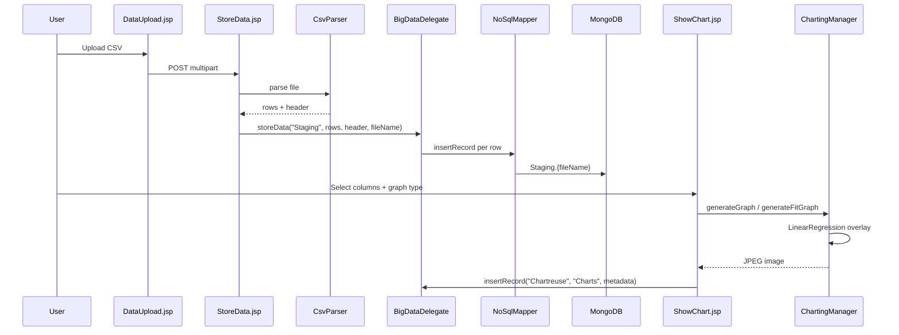
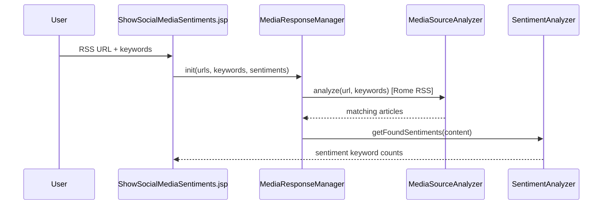

# Chartreuse Architecture

Chartreuse is a **metadata-driven Java EE web application** branded as **Architect Corner**. It demonstrates the AI-Coder runtime framework: XML-configured CRUD, multi-tier JDBC persistence, MongoDB big-data ingestion, Java2D charting, and RSS/sentiment analysis — all served through JSP pages on Apache Tomcat.

## System Context



## Project Structure

```
Chartreuse/
├── src/org/archcorner/chartreuse/       # Core application (69 Java files)
│   ├── metadata/                        # AppConfigManager, MetadataManager
│   ├── businessdelegate/                # Entity + BigData delegates
│   ├── businessservices/                # String-tokenized service layer
│   ├── dal/dao/                         # JDBC DAOs
│   ├── pojo/                            # Entity beans
│   ├── util/                            # JDBCManager, XMLUtil
│   ├── esb/                             # CsvParser, DataValidator
│   ├── charting/                        # ChartingManager (Java2D)
│   └── bigdata/
│       ├── dataservices/                # NoSqlMapper, MapReduce stubs
│       ├── datascience/                 # LinearRegression
│       ├── management/                  # JobManager, Task framework
│       └── processing/                  # NodeManager stubs
├── src/org/architectcorner/ai/
│   └── mediaresponse/                   # RSS + sentiment analysis
├── WebContent/                          # JSP web root
│   ├── WEB-INF/web.xml
│   └── *.jsp
├── belfortappconfig.xml                 # Entity/view/form metadata
└── build/classes/                       # Compiled output
```

## Layered Architecture

### 1. Presentation Layer — JSP

All request handling is done in **JSP scriptlets** — there are no servlets, filters, or MVC framework. Pages fall into five functional groups:

| Group | Pages | Role |
|-------|-------|------|
| Auth | `Login.jsp`, `LoginUser.jsp`, `Logout.jsp` | Credential check via `UserBusinessDelegate` |
| Metadata CRUD | `CRUDPage`, `FormPage`, `ListView`, `StoreEntity`, `UpdatePage`, `EditPage`, `DeletePage`, `DeleteEntityPage` | Generic entity management driven by XML config |
| Big Data | `DataUpload`, `StoreData`, `GenerateGraph`, `ShowChart`, `DataChart`, `EditData` | CSV upload, MongoDB storage, chart generation |
| Analytics dashboards | `churn`, `loyalpoints`, `charges`, `revenue`, `topup`, `projection_*`, `profiles`, `offers`, `miles`, `ancillary`, `sentiments` | Static chart images (telecom/airlines) |
| AI / Sentiment | `nonspeech`, `ShowSentiments`, `socialmedianalysis`, `ShowSocialMediaSentiments` | Text and RSS sentiment analysis |

Navigation hub: `index.jsp` (Architect Corner home).

### 2. Metadata Layer

Two classes bridge XML configuration and runtime behavior:

**AppConfigManager** reads `belfortappconfig.xml` and resolves:
- View fields by `viewno` or view name
- Form fields by `formno`
- Update/delete search fields and ID fields

**MetadataManager** uses **Java Reflection** to dispatch CRUD without entity-specific JSP code:

| Operation | Convention |
|-----------|------------|
| Insert | `{Entity}BusinessDelegate.insert{Entity}({Entity})` |
| Update | `{Entity}BusinessDelegate.update{Entity}({Entity})` |
| Delete | `{Entity}BusinessDelegate.delete{Entity}({Entity})` |
| Get by ID | `{Entity}BusinessDelegate.get{Entity}ById(int)` |
| List all | `{Entity}BusinessDelegate.getAll()` |

POJO setters are invoked reflectively: `set{Field}(value)` on `org.archcorner.chartreuse.pojo.{Entity}`.

### 3. Business Layer

**BusinessDelegate** — thin facade, one class per entity plus `BigDataDelegate`:

```java
// CustomerBusinessDelegate pattern
public void insertCustomer(Customer customer) {
    CustomerDAO customerDAO = new CustomerDAO();
    customerDAO.insertCustomer(customer);
}
```

Each method creates a new DAO instance (no connection pooling or singleton).

**BusinessServices** — parallel service layer accepting `@@`-delimited property strings (e.g. `CustomerService`). Used as an alternative integration pattern; JSPs primarily call BusinessDelegates via MetadataManager.

### 4. Data Access Layer

**DAOs** (9 entities) — raw JDBC via `JDBCManager`:
- `CustomerDAO`, `DisasterDAO`, `OrderDAO`, `PartnerDAO`, `ProductDAO`, `ResourceDAO`, `UserDAO`, `VendorDAO`
- Pattern: `PreparedStatement` CRUD, `getHighestId()` for manual auto-increment

**NoSqlMapper** — MongoDB CRUD using the legacy `MongoClient` API:
- Insert/update/delete/query documents
- Used by `BigDataDelegate` for CSV staging and chart metadata storage

### 5. Data Stores

| Store | Connection | Usage |
|-------|------------|-------|
| MySQL `belfort` | `jdbc:mysql://localhost:3306/belfort` | Entity CRUD (users, customers, orders, etc.) |
| MongoDB | `localhost:27017` | CSV staging (`Staging` DB), chart records (`Chartreuse.Charts`) |

Credentials are hardcoded in `JDBCManager.java` (user/password: `root`/`root`).

## Entity Model

Eight entities configured in `belfortappconfig.xml`:

| Form # | Entity | Key fields |
|--------|--------|------------|
| 1 | User | userId, userName, password |
| 2 | Disaster | disasterId, disasterName, locationName, eventDescription, contactNo, reporterName |
| 3 | Customer | customerId, customerName, streetAddress, city, state, country, zipCode, contactNo |
| 4 | Order | orderId, customerName, productName, productModel, orderDate, deliveryDate, contactNo |
| 5 | Product | productId, productName, productModel, description |
| 6 | Resource | resourceId, name, type, startDate |
| 7 | Vendor | vendorId, vendorName, vendorAddress, vendorCity, vendorState, vendorCountry |
| 8 | Partner | partnerId, partnerName, partnerAddress, partnerCity, partnerState, partnerCountry |

Each entity has matching POJO, DAO, BusinessDelegate, and (for most) BusinessService classes.

## Metadata Configuration

`belfortappconfig.xml` defines four sections per entity:

```xml
<view>    <!-- list columns (viewno, viewFields) -->
<form>    <!-- create fields (formno, formFields) -->
<update>  <!-- edit: formIdField, searchFormField, formFields -->
<delete>  <!-- delete: formidField, searchFormField, formFields -->
```

Example (User):

```xml
<view>
    <name>User</name>
    <viewno>1</viewno>
    <viewFields>
        <viewField>UserId</viewField>
        <viewField>UserName</viewField>
        <viewField>Password</viewField>
    </viewFields>
</view>
```

Adding a new entity requires: POJO + DAO + BusinessDelegate classes following naming conventions, plus XML entries in `belfortappconfig.xml`. No new JSP pages are needed — the generic CRUD JSPs handle all entities.

## Request Flows

### Metadata-Driven CRUD



### Big Data Ingestion & Charting



### Sentiment Analysis



## Package Reference

| Package | Classes | Responsibility |
|---------|---------|----------------|
| `metadata` | `AppConfigManager`, `MetadataManager` | XML config + reflection dispatch |
| `businessdelegate` | 9 entity delegates + `BigDataDelegate` | Business logic facade |
| `businessservices` | 7 `*Service` classes | Tokenized CRUD operations |
| `dal.dao` | 9 `*DAO` classes | JDBC persistence |
| `pojo` | 9 entity beans | Data transfer objects |
| `util` | `JDBCManager`, `XMLUtil` | DB connections, DOM parsing |
| `esb` | `CsvParser`, `DataValidator` | File parsing and validation |
| `charting` | `ChartingManager` | Java2D bar/line/pie/fit charts |
| `bigdata.dataservices` | `NoSqlMapper`, `Mapper`, `Reducer` stubs | MongoDB + MapReduce scaffolding |
| `bigdata.datascience` | `LinearRegression` | OLS regression, R², standard errors |
| `bigdata.management` | `JobManager`, `Job`, `Task`, `BigDataTask` | Job orchestration (skeletal) |
| `bigdata.processing` | `NodeManager`, `ResourceManager` | Cluster node stubs |
| `ai.mediaresponse.manager` | `MediaResponseManager`, `MediaSourceAnalyzer` | RSS feed analysis |
| `ai.mediaresponse.sentiment` | `SentimentAnalyzer` | Keyword-based sentiment scoring |
| `ai.mediaresponse.util` | `WebApp`, `HTMLUtil`, `URLHelper`, `RTFUtil` | HTML crawling utilities |

## Technology Stack

| Component | Technology |
|-----------|------------|
| Language | Java 9 |
| Web container | Apache Tomcat 9.0 |
| Web standard | Servlet 3.1, JSP |
| RDBMS | MySQL 5.x (`mysql-connector-java-5.1.45`) |
| NoSQL | MongoDB 3.6 (`mongodb-driver-3.6.3`) |
| XML | JDOM + W3C DOM |
| RSS | Rome 1.0 (`com.sun.syndication`) |
| Charting | Java2D (`BufferedImage`, `Graphics2D`) |
| Frontend | Bootstrap, jQuery, custom CSS |
| Build | Eclipse WTP (no Maven/Gradle) |

## Design Patterns

| Pattern | Where |
|---------|-------|
| Metadata-driven UI | XML config drives generic JSP forms and lists |
| Reflection-based dispatch | `MetadataManager` resolves classes by naming convention |
| Business Delegate | `{Entity}BusinessDelegate` between JSP and DAO |
| DAO | `{Entity}DAO` with raw JDBC |
| Service Layer | `{Entity}Service` with delimited string operations |
| POJO / JavaBean | Entity classes with getters/setters |
| MapReduce (skeletal) | `Mapper`/`Reducer`/`JobManager` — stubs, not production-ready |

## Relationship to AI-Coder

Chartreuse is the **runtime reference application** for the AI-Coder neural sketch framework:

- **GoldenRod** (separate branch) generates POJO, DAO, and BusinessDelegate source code from entity metadata.
- **Chartreuse** consumes that generated code and adds metadata-driven JSP rendering, big-data analytics, and AI modules on top.
- Generated Java classes (e.g. `PartnerDAO`) import from `org.archcorner.chartreuse.*` packages, making Chartreuse the target runtime for code generation output.

## Configuration Notes

| Item | Location | Note |
|------|----------|------|
| App metadata | `belfortappconfig.xml` (project root) | Copy at project root; `AppConfigManager` hardcodes a developer path — update before deployment |
| DB credentials | `JDBCManager.java` | Hardcoded `root`/`root` |
| Web descriptor | `WebContent/WEB-INF/web.xml` | No servlets; welcome file includes `Login.jsp` |
| Dependencies | `WebContent/WEB-INF/lib/` | Rome RSS JAR; MySQL/Mongo drivers on Eclipse classpath |

## Known Limitations

1. **No session enforcement** — login validates credentials but other pages lack auth middleware.
2. **Hardcoded config path** — `AppConfigManager` points to `/Users/bhagvan.kommadi/Documents/AIPredict/Chartreuse/belfortappconfig.xml`.
3. **Analytics dashboards are static** — telecom/airline JSPs display pre-rendered JPEG images, not live data.
4. **MapReduce layer is scaffolding** — `Mapper`, `Reducer`, `RDBMSMapper`, `NodeManager` are empty or stub implementations.
5. **Package naming inconsistency** — core uses `org.archcorner`, AI modules use `org.architectcorner`.
6. **New DAO per call** — BusinessDelegates instantiate a fresh DAO on every method invocation.
